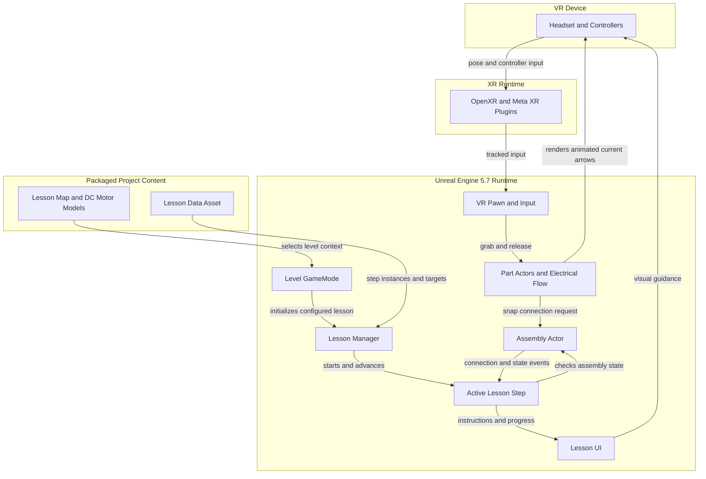
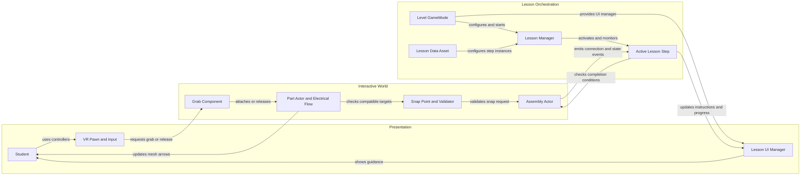

# Architecture Diagram

MechatronicsVR is an Unreal Engine VR training application in which students manipulate simulated parts while following level-configured lessons. These diagrams show the current runtime boundary and the main component relationships.

## Application Architecture

<!-- mermaid-checked: no \n, no em-dash/en-dash, no {} in labels, subgraphs are id["label"], arrows are -->|"label"|, all subgraphs closed by end, ids unique -->

### Technology Stack Summary

| Layer | Technology | Version | Purpose |
|---|---|---|---|
| Runtime | Unreal Engine | 5.7 | VR application runtime, world and physics |
| Application | C++ with Blueprint integration | C++ standard follows Unreal toolchain | Lesson, interaction and assembly logic; editor-authored actors and content |
| VR input | Enhanced Input and HeadMountedDisplay | Unreal Engine 5.7 modules | Controller input and headset tracking |
| XR integration | OpenXR and OculusXR plugins | Enabled in project; plugin versions managed by Unreal | Connect the application to supported XR runtimes |
| Lesson content | Unreal maps, Blueprints and Data Assets | `.umap` and `.uasset` project assets | Per-level scenes, lesson definitions and interactive content |
| UI | UMG and Widget Components | Unreal Engine 5.7 | In-world instruction and progress displays |

### Data Storage & External Services

The application has no database, cache, message broker, or required web service. Lesson definitions and scenes are Unreal project assets; active step and assembly state are held in memory. `UMechatronicsGameInstance` includes lesson progression and save/load entry points, but its save/load functions are placeholders that currently only log activity.

### Key Architectural Decisions

- Each level's GameMode owns the lesson and UI manager components and can auto-start its configured lesson Data Asset. The GameInstance persists across level changes but is not the per-level lesson initializer.
- Lesson Data Assets hold configured step instances and target part classes; the Lesson Manager sequences the steps and updates the UI.
- Part Actors can render configurable linear or circular electrical-flow arrows on their meshes; this is visual behavior, not a circuit simulation or separate service.
- Part assembly currently records compatible snap connections and state. Physics-constraint creation in `AAssemblyActor::ConnectParts` is disabled, so logical assembly should not be mistaken for a guaranteed physical joint.

## Component Relationships

<!-- mermaid-checked: no \n, no em-dash/en-dash, no {} in labels, subgraphs are id["label"], arrows are -->|"label"|, all subgraphs closed by end, ids unique -->

### Component Inventory

| Component | Layer | Type | Responsibility |
|---|---|---|---|
| VR Pawn and Input | Presentation | Blueprint / Unreal Pawn | Receives tracked controller input and initiates VR interactions |
| Lesson UI Manager | Presentation | Actor Component | Presents instruction, progress and highlighting through Unreal widgets |
| Level GameMode | Orchestration | C++ base with Blueprint configuration | Creates lesson managers and initializes the level's configured lesson |
| Lesson Manager | Orchestration | Actor Component | Loads configured step instances, activates steps, tracks progression and updates UI |
| Lesson Data Asset | Content | Unreal Data Asset | Stores lesson metadata, step instances, target parts and level association |
| Active Lesson Step | Orchestration | C++ UObject subclasses | Defines the active instruction and checks its completion condition |
| Part Actor | Interactive World | C++ Actor with Blueprint subclasses | Represents a physics-enabled part; handles grab, preview, snap and configurable electrical-flow arrows |
| Grab Component | Interactive World | Scene Component | Attaches a part to a motion controller and handles release |
| Snap Point and Validator | Interactive World | Scene / Actor Components | Tests snap-point and part compatibility, including active assembly-step targets |
| Assembly Actor | Interactive World | C++ Actor | Tracks parts, logical connections and assembly state; emits state-change events |
